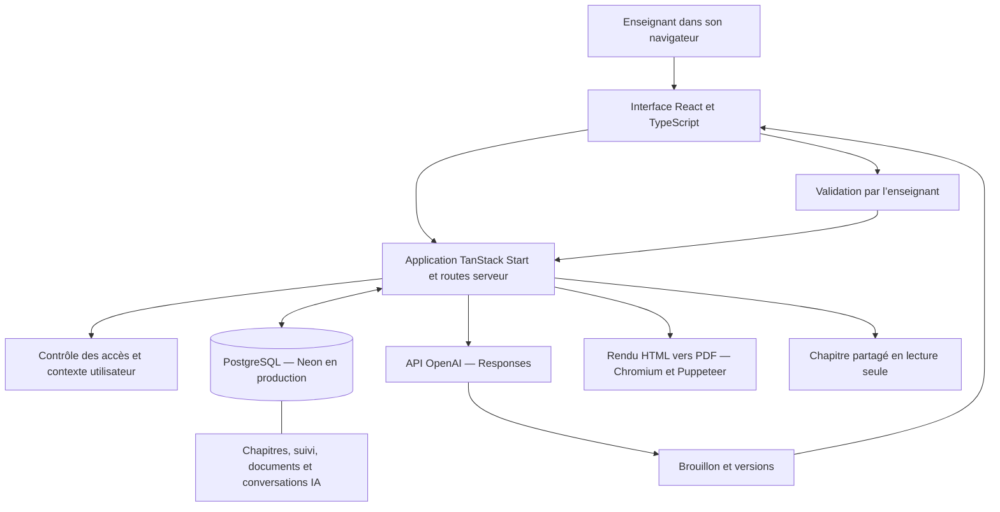
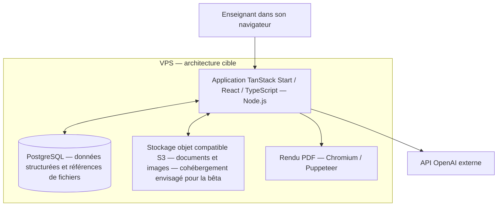
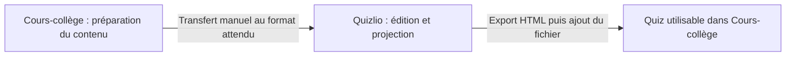

# Architecture de Séquencia

Cette présentation décrit les principaux composants observés dans le projet au 11 octobre 2026 et l’architecture cible précisée par Henri. Elle documente l’application sans publier son code source.

Séquencia est le nom affiché par la nouvelle interface du projet Cours-college. Les nouvelles captures illustrent la création d’une correction à partir d’une évaluation, puis une deuxième proposition après une demande complémentaire. Les évolutions VPS et stockage S3 restent présentées comme prévues.

## Framework, langages et services

| Rôle | Technologie |
|---|---|
| Framework applicatif | TanStack Start |
| Interface et routage | React et TanStack Router |
| Langage principal | TypeScript |
| Documents et styles | HTML et CSS |
| Exécution serveur | Node.js |
| Construction et adaptation au déploiement | Vite et Nitro |
| Base de données | PostgreSQL ; Neon en production, PostgreSQL Docker en développement |
| IA | API OpenAI Responses, appelée côté serveur |
| PDF | Chromium avec Puppeteer ; manipulation de PDF avec pdf-lib |
| Hébergement actuel | Vercel |

## Stockage actuel

Les données structurées de l’application, notamment chapitres, suivi et conversations IA, sont persistées dans PostgreSQL. La base de production est hébergée sur Neon.

Les ressources documentaires intégrées sont empaquetées côté serveur. Les fichiers importés ou générés sont actuellement enregistrés en base, avec leur contenu encodé en base64. Le chargement d’un document consulte les ressources intégrées ou la table des documents importés.

Le stockage objet compatible S3 est prévu dans l’évolution de l’architecture.

## Vue générale actuelle

L’interface et les traitements serveur font partie de la même application. Les appels à OpenAI et l’accès à la base sont réalisés côté serveur.

Le projet utilise Vite et Nitro pour la construction et le déploiement sur Vercel. Le développement utilise PostgreSQL dans Docker ; la production utilise Neon.

## Architecture cible sur VPS

La migration prévue regroupe l’application et PostgreSQL sur un même VPS. Les fichiers des documents et les images seront placés dans un stockage objet compatible S3. Pour la phase bêta, l’hébergement de ce stockage sur le même VPS est envisagé ; le service exact reste à choisir.

PostgreSQL conserve les données métier et les références des fichiers ; le stockage objet héberge les documents et images. « Compatible S3 » désigne ici le mode d’accès au stockage, sans impliquer un hébergement sur Amazon S3.

Cette cible décrit les évolutions prévues. Le déploiement actuel reste sur Vercel avec PostgreSQL sur Neon.

## Préparation d’un document avec l’IA

1. L’enseignant choisit le chapitre, la destination, le type de document et une éventuelle référence.
2. Le serveur prépare le contexte pédagogique : niveau, chapitre, séance, partie et éléments de suivi utiles.
3. La consigne et les images sélectionnées complètent la demande envoyée à OpenAI.
4. L’application reçoit une proposition de document et la conserve comme brouillon.
5. L’enseignant consulte la proposition, peut demander d’autres ajustements et sélectionner une version.
6. Après validation, le document est enregistré et son PDF peut être produit.

Le rendu PDF est assuré par l’application à partir du HTML. La validation de l’enseignant distingue une proposition IA du document retenu dans le chapitre.

## Révision et portée des modifications

Les conversations conservent les demandes successives et les versions des documents. Le parcours permet de repartir de la version choisie et de compléter une demande par une capture d’une zone.

Lorsqu’un document est partagé entre plusieurs parties, l’utilisateur choisit la portée de sa modification : mise à jour des utilisations concernées ou création d’une copie pour une seule partie.

## Organisation des données et des accès

- Les contenus pédagogiques sont organisés par niveaux, chapitres, séances et parties.
- Le suivi est distingué par classe et année scolaire.
- Les routes serveur contrôlent les accès aux données et aux ressources.
- Le partage d’un chapitre repose sur un lien de lecture seule révocable.
- Le mode projection adapte les documents affichés au public de la classe.

Le projet comporte également une gestion de comptes et d’espaces enseignants. Son activation dépend de la configuration du déploiement ; elle n’est pas présentée ici comme une inscription publique ouverte.

## Relation actuelle avec Quizlio

Le quiz HTML peut être consulté comme une ressource. La liaison automatique entre les applications est prévue ; elle ne fait pas partie du fonctionnement illustré par les captures.

## Périmètre de cette documentation

L’architecture actuelle a été décrite à partir du manifeste de dépendances, de la configuration de déploiement et des modules de stockage, de traitement des documents et de l’IA. La cible VPS et S3 reprend les orientations indiquées par Henri. Aucun test de fonctionnement ou audit de sécurité supplémentaire n’est revendiqué par cette documentation.
