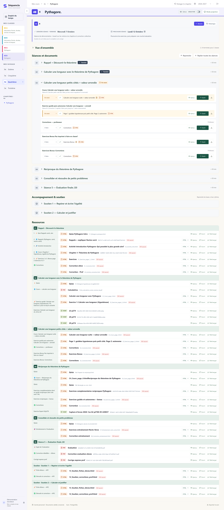
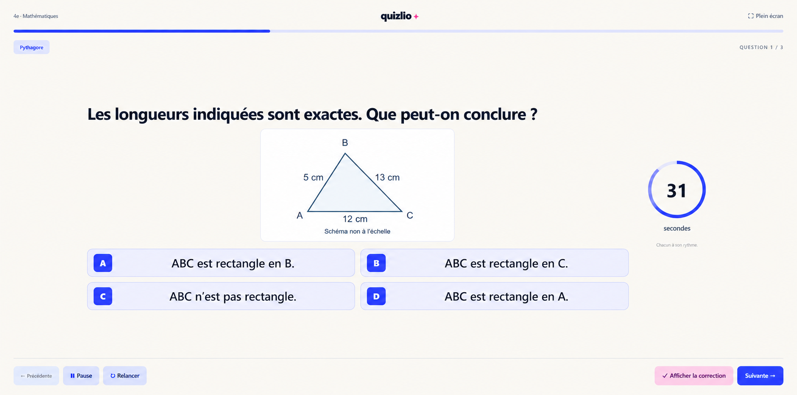
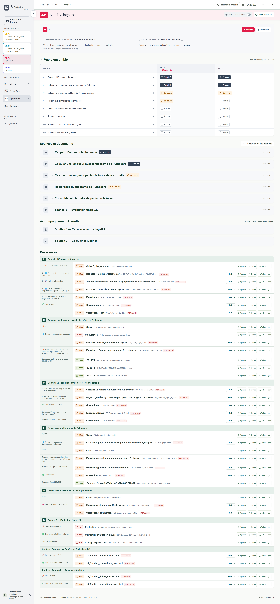
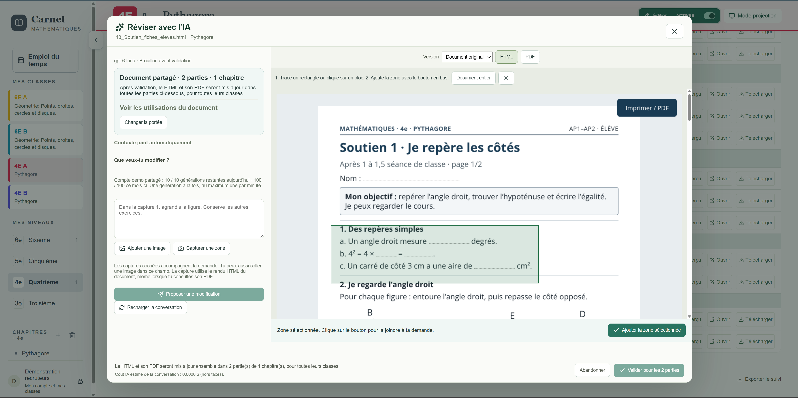
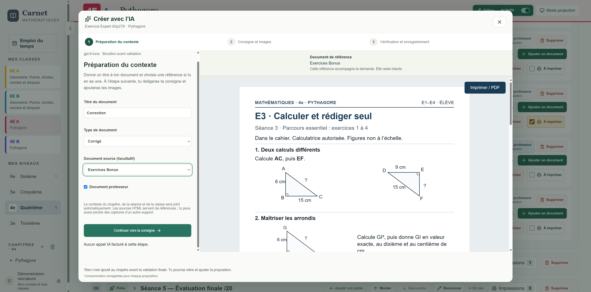
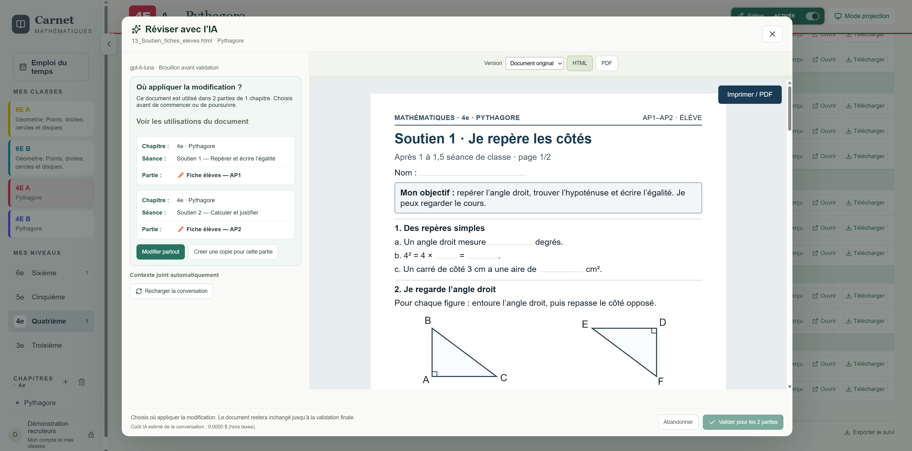
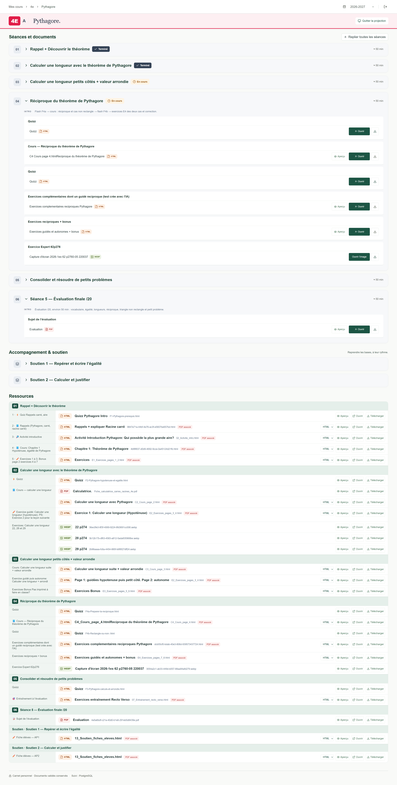
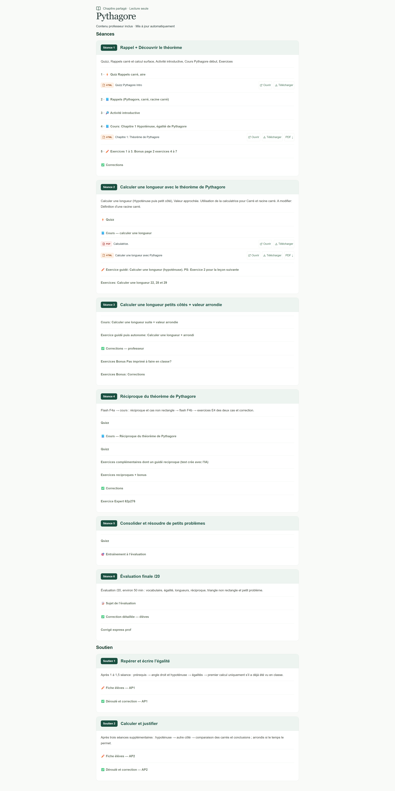
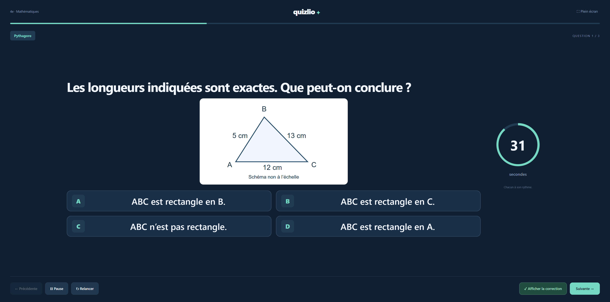

# Séquencia en images

[← Présentation](README.md) · [Découvrir l’application](https://cours-college.vercel.app/presentation) · [Architecture](ARCHITECTURE.md)

## Dans l’application

Les captures sont affichées directement ci-dessous. Un clic permet seulement de les agrandir.

<table>
  <tr>
    <td width="50%" valign="top">
      <h3>Les séances et le suivi des classes</h3>
      
    </td>
    <td width="50%" valign="top">
      <h3>Un quiz prêt à projeter</h3>
      
      
Quiz HTML importé de Quizlio, aux couleurs de Séquencia.

    </td>
  </tr>
  <tr>
    <td width="50%" valign="top">
      <h3>Partir d’une évaluation</h3>
      
      
Choisir le document source et le résultat attendu.

    </td>
    <td width="50%" valign="top">
      <h3>Affiner le corrigé proposé</h3>
      
      
Demander un ajustement, comparer les versions, puis valider.

    </td>
  </tr>
</table>

Les visuels de l’[accueil du dépôt](README.md) sont des compositions simplifiées. Ces captures montrent les écrans de référence ; le corrigé y est encore une proposition avant enregistrement.

## Les premières versions

Ces captures historiques montrent l’ancienne identité « Carnet · Mathématiques ».

<table>
  <tr>
    <td width="33%" align="center"><strong>Vue d’ensemble</strong> </td>
    <td width="33%" align="center"><strong>Révision ciblée avec l’IA</strong> </td>
    <td width="33%" align="center"><strong>Création avec l’IA</strong> </td>
  </tr>
  <tr>
    <td align="center"><strong>Portée d’une modification</strong> </td>
    <td align="center"><strong>Projection en classe</strong> </td>
    <td align="center"><strong>Chapitre partagé</strong> </td>
  </tr>
  <tr>
    <td align="center"><strong>Quiz HTML</strong> </td>
    <td align="center"><strong>Édition des séances</strong> </td>
    <td align="center"><strong>Aperçu d’un document</strong> </td>
  </tr>
</table>

[Ancienne capture de la page de présentation](assets/11-sequencia-presentation.png)
