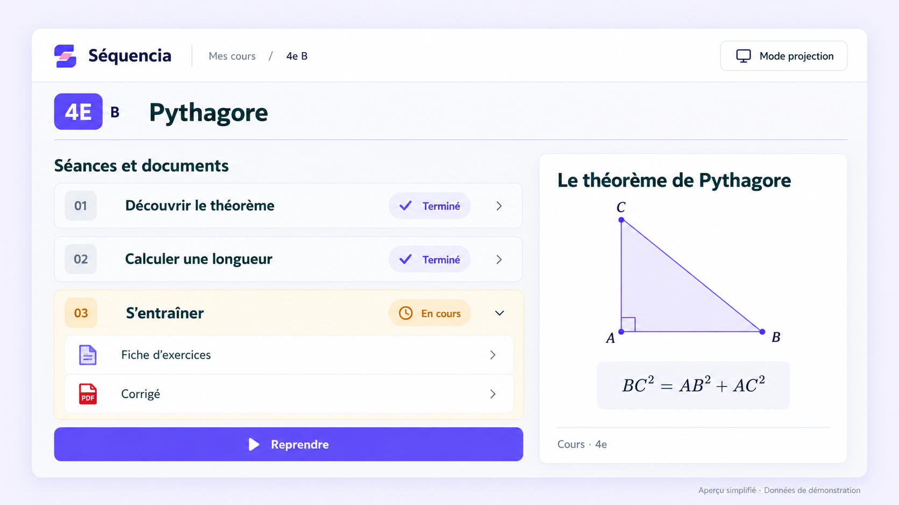
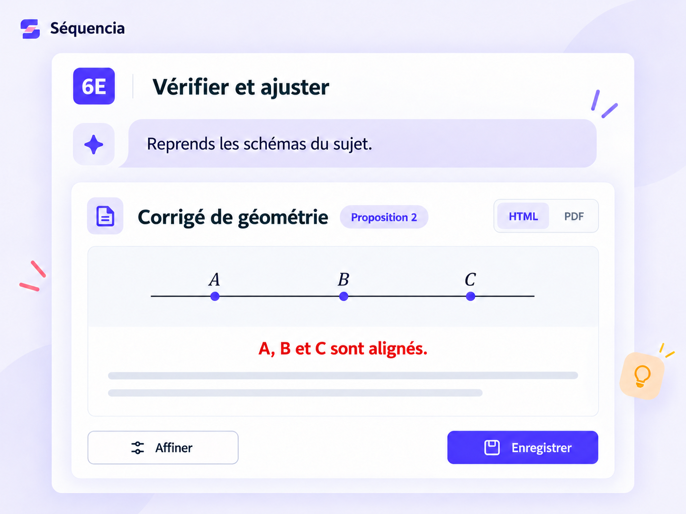
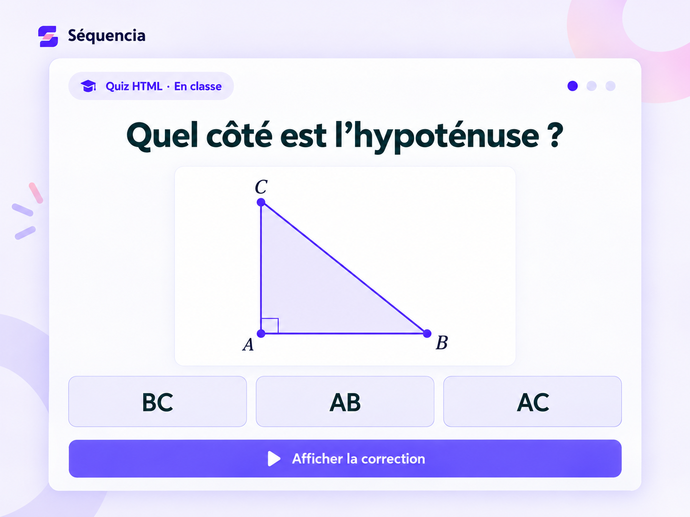
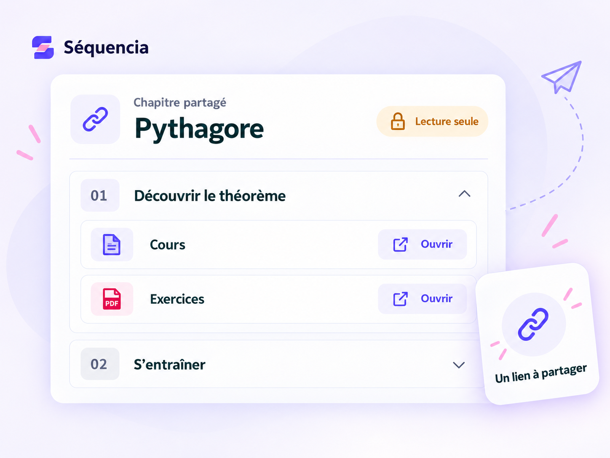

# Séquencia

### Préparez. Projetez. Reprenez.

Vos séances, vos documents et l’avancement de chaque classe, au même endroit. Avec l’IA pour préparer vos supports, et la main sur le résultat.

**[Découvrir l’application →](https://cours-college.vercel.app/presentation)** · [Captures réelles](GALERIE.md) · [Architecture](ARCHITECTURE.md)

## De la préparation à la classe

<table>
  <tr>
    <td width="50%" valign="top">
      
      <h3>Préparer avec l’IA</h3>
      
Partez de vos documents pour créer exercices, évaluations et corrigés.

    </td>
    <td width="50%" valign="top">
      
      <h3>Garder la main</h3>
      
Précisez votre demande, relisez la proposition et choisissez ce que vous enregistrez.

    </td>
  </tr>
  <tr>
    <td width="50%" valign="top">
      
      <h3>Faire participer la classe</h3>
      
Ouvrez vos supports et vos quiz HTML, puis affichez la correction ensemble.

    </td>
    <td width="50%" valign="top">
      
      <h3>Partager avec un collègue</h3>
      
Transmettez un chapitre en lecture seule, sans partager le suivi de vos classes.

    </td>
  </tr>
</table>

Visuels recomposés pour illustrer les usages de Séquencia. Les quiz Quizlio sont importés en HTML.

---

Conçu et développé par **[Henri Teinturier](https://github.com/HenriTeinturier)** à partir de son activité d’enseignant.

**React · TypeScript · TanStack Start · PostgreSQL · OpenAI**

En développement et utilisé en cours · Accès sur invitation · Code source privé

[Visiter Séquencia →](https://cours-college.vercel.app/presentation) · [Échanger sur LinkedIn](https://www.linkedin.com/in/henri-teinturier/)
