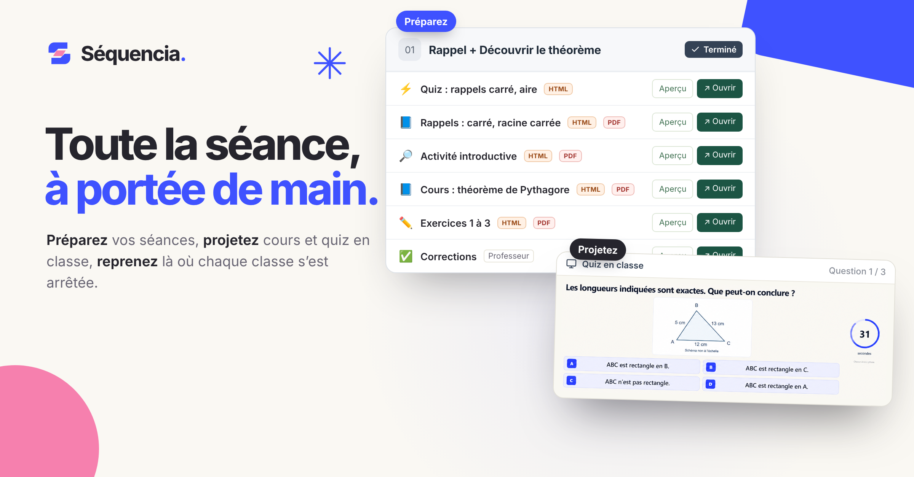
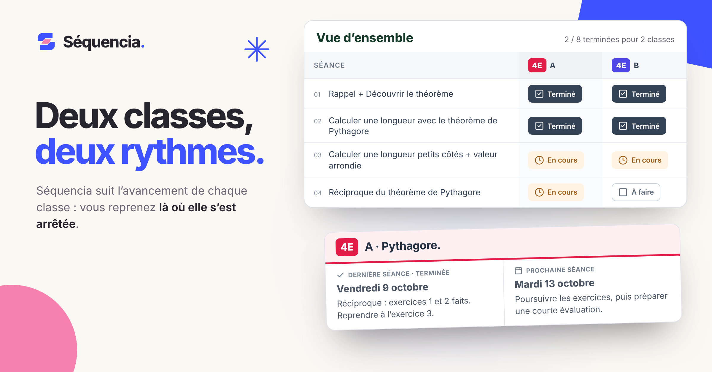

# Séquencia

### Préparez. Projetez. Reprenez.

Vos séances, vos documents et l’avancement de chaque classe, au même endroit. Utilisée tous les jours en classe. L’IA aide à créer ou retoucher un document, et vous gardez la main sur le résultat.

**[Découvrir l’application →](https://cours-college.vercel.app/presentation)** · [Captures réelles](GALERIE.md) · [Architecture](ARCHITECTURE.md)

## Au quotidien

<table>
  <tr>
    <td width="50%" valign="top">
      
      <h3>Suivre chaque classe</h3>
      
Chaque classe avance à son rythme : la dernière séance, la suivante et l’état de chaque séance restent visibles.

    </td>
    <td width="50%" valign="top">
      
      <h3>Créer et retoucher avec l’IA</h3>
      
À partir d’un sujet, l’IA propose par exemple la correction élève et le corrigé prof avec le barème. Vous relisez et ajustez.

    </td>
  </tr>
</table>

**Et aussi :** mode projection pour la classe, quiz HTML importés depuis Quizlio, partage d’un chapitre avec un collègue en lecture seule.

Visuels réalisés à partir de l’application et de son compte de démonstration.

---

Conçu et développé par **[Henri Teinturier](https://github.com/HenriTeinturier)** à partir de son activité d’enseignant.

**React · TypeScript · TanStack Start · PostgreSQL · OpenAI**

En développement et utilisé en cours · Accès sur invitation · Code source privé

[Visiter Séquencia →](https://cours-college.vercel.app/presentation) · [Échanger sur LinkedIn](https://www.linkedin.com/in/henri-teinturier/)
