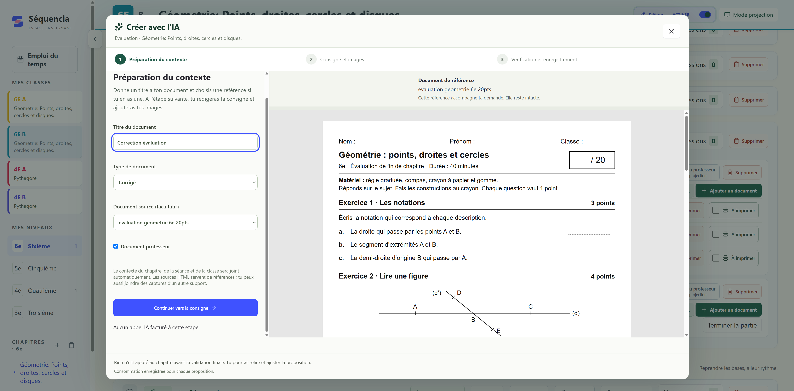
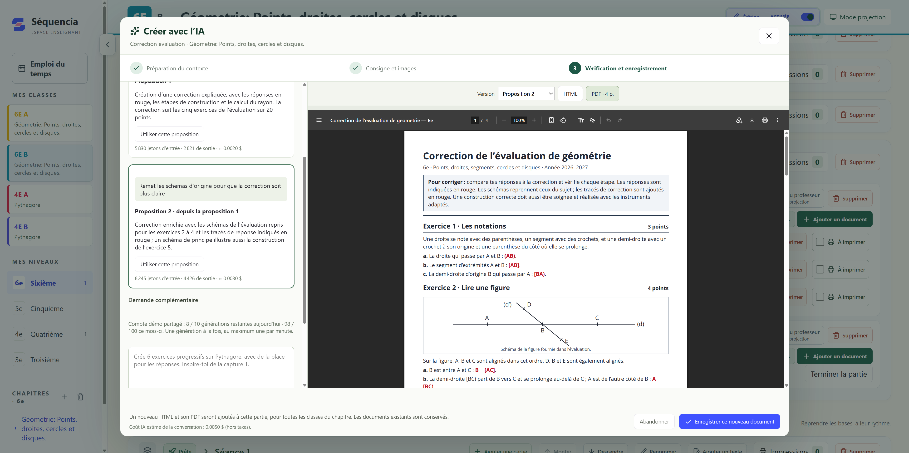

# Séquencia
### Préparer, enrichir et suivre ses cours avec l’IA

**Un outil métier développé à partir de mon activité d’enseignant.**

Séquencia, développé sous le nom de projet Cours-collège, rassemble les chapitres, séances et documents pédagogiques, avec un suivi distinct pour chaque classe. L’IA intervient dans la préparation et la révision des supports, au sein du contexte de travail de l’enseignant.

Ce dépôt présente le projet, ses fonctionnalités et son architecture. Le code source de l’application est privé.

[Architecture](ARCHITECTURE.md) · [Galerie des captures](GALERIE.md) · [Contacter Henri sur LinkedIn](https://www.linkedin.com/in/henri-teinturier/)

## Technologies et hébergement

**TanStack Start · React · TypeScript · PostgreSQL · OpenAI**

| Composant | Architecture actuelle | Évolution prévue |
|---|---|---|
| Framework et interface | TanStack Start, TanStack Router et React | Conservation de cette base applicative |
| Langages et présentation | TypeScript, HTML et CSS | — |
| Serveur et construction | Node.js, Vite et Nitro | Déploiement de l’application sur VPS |
| Base de données | PostgreSQL hébergé sur Neon | PostgreSQL hébergé sur le même VPS que l’application |
| Documents et images | Ressources intégrées au serveur et fichiers importés ou générés conservés en base | Stockage objet compatible S3 ; hébergement sur le même VPS envisagé pendant la bêta |
| Hébergement de l’application | Vercel | VPS commun avec PostgreSQL |
| Intelligence artificielle | API OpenAI appelée côté serveur | — |
| Production des PDF | Chromium/Puppeteer et pdf-lib | — |

La migration VPS et le stockage compatible S3 constituent l’architecture cible. Le service de stockage S3 auto-hébergé reste à choisir.

Les données structurées restent dans PostgreSQL ; la cible S3 concerne les fichiers des documents et les images.

## Le besoin

Préparer un chapitre demande de rassembler cours, exercices, corrections et évaluations, puis de les adapter aux séances et de suivre leur avancement selon les classes.

J’ai conçu cette application pour regrouper ces éléments et pouvoir les faire évoluer au même endroit : organisation, consultation, création de supports, projection et partage.

## Ce que permet l’application

- **Organiser** les chapitres en séances, parties et ressources.
- **Suivre** l’avancement, les bilans et les prochaines étapes de chaque classe.
- **Créer avec l’IA** un cours, une fiche d’exercices, une évaluation ou une correction, avec ou sans document de référence.
- **Réviser avec l’IA** un document en donnant une consigne, en ajoutant une image ou en sélectionnant une zone.
- **Choisir la portée d’une modification** : mettre à jour les utilisations communes du document ou créer une copie pour une partie.
- **Projeter en classe** les supports destinés aux élèves, en masquant les documents réservés au professeur.
- **Partager un chapitre** en lecture seule avec un autre enseignant, sans son suivi classe par classe.
- **Utiliser des quiz HTML** exportés depuis Quizlio.

## L’IA intégrée au travail de préparation

### D’une évaluation à une correction retravaillée

**1. Choisir le document de référence et le résultat attendu.**

Dans cet exemple, l’enseignant sélectionne une évaluation de géométrie de sixième comme référence, choisit le type « Corrigé » et donne un titre au nouveau document. Le contexte du chapitre, de la séance et de la classe accompagne automatiquement la demande.

**2. Affiner la proposition en conservant le contexte.**

Une première correction est générée. L’enseignant demande ensuite de reprendre les schémas d’origine pour rendre la correction plus claire. L’application affiche une deuxième proposition, son aperçu PDF et les versions disponibles.

**3. Relire, choisir et enregistrer.**

Le résultat peut être consulté en HTML ou en PDF. L’enseignant choisit la proposition à retenir, puis enregistre le nouveau document dans le chapitre. La capture montre la proposition prête à être validée ; elle précède l’enregistrement final.

### Réviser un document avec son contexte

L’enseignant peut également sélectionner une zone du support, joindre des images et préciser la modification attendue. Les échanges successifs et les versions permettent de retravailler la proposition avant de choisir celle à enregistrer.

[Voir la sélection d’une zone dans l’interface précédente](assets/02-revision-ia-zone.png)

### Garder la maîtrise des documents partagés

Un même document peut être utilisé dans plusieurs parties. L’application permet de choisir entre une modification commune et une copie propre à une partie. Cette décision intervient avant la validation du résultat.

[Voir le choix de la portée d’une modification dans l’interface précédente](assets/04-portee-modification.png)

## De la préparation à la classe

| Situation | Fonctionnement |
|---|---|
| Préparer le chapitre | Séances, documents, corrections et soutiens regroupés dans un espace commun. |
| Suivre plusieurs classes | Vue d’ensemble des progressions et suivi propre à la classe sélectionnée. |
| Présenter un support | Aperçu intégré et mode projection qui masque les ressources réservées au professeur. |
| Partager avec un collègue | Chapitre en lecture seule, avec les documents autorisés, sans le suivi des classes. |

[Vue actuelle de l’application](assets/10-sequencia-application.png) · [Page de présentation de Séquencia](assets/11-sequencia-presentation.png)

Les vues de projection, partage et édition de l’interface précédente sont conservées dans la [galerie complémentaire](GALERIE.md).

## Le lien avec Quizlio

[Voir un exemple de quiz HTML exporté de Quizlio, dans sa présentation précédente](assets/07-quiz-quizlio.png)

Les quiz exportés en HTML depuis Quizlio peuvent être utilisés dans Séquencia. Dans le parcours décrit ici, Séquencia peut également préparer un contenu au format attendu par Quizlio ; le transfert reste manuel.

La connexion automatique entre les deux applications est une évolution prévue. Le visuel présente un quiz exporté, pas l’éditeur Quizlio.

## Ma contribution

Je définis le besoin à partir de mon usage d’enseignant, organise les fonctionnalités et développe l’application avec l’appui de Codex et Claude Code. Je pilote les choix de fonctionnement, l’intégration de l’IA et les ajustements issus de l’utilisation.

Ce projet associe conception d’un outil métier, développement web, intégration d’API, gestion documentaire et attention portée au contrôle laissé à l’utilisateur.

## État du projet

Application personnelle en développement et utilisée pour mon activité d’enseignant. Les captures principales montrent la nouvelle identité Séquencia, sa page de présentation et un exemple réel de création de correction avec l’IA. Les anciennes vues « Carnet · Mathématiques » sont conservées comme compléments identifiés dans la galerie.

Les fonctionnalités disponibles et les évolutions prévues sont distinguées dans cette présentation.

## Contact

**Henri Teinturier — IA, automatisation et applications métier**

[Échanger sur LinkedIn](https://www.linkedin.com/in/henri-teinturier/) · [Profil GitHub](https://github.com/HenriTeinturier)
